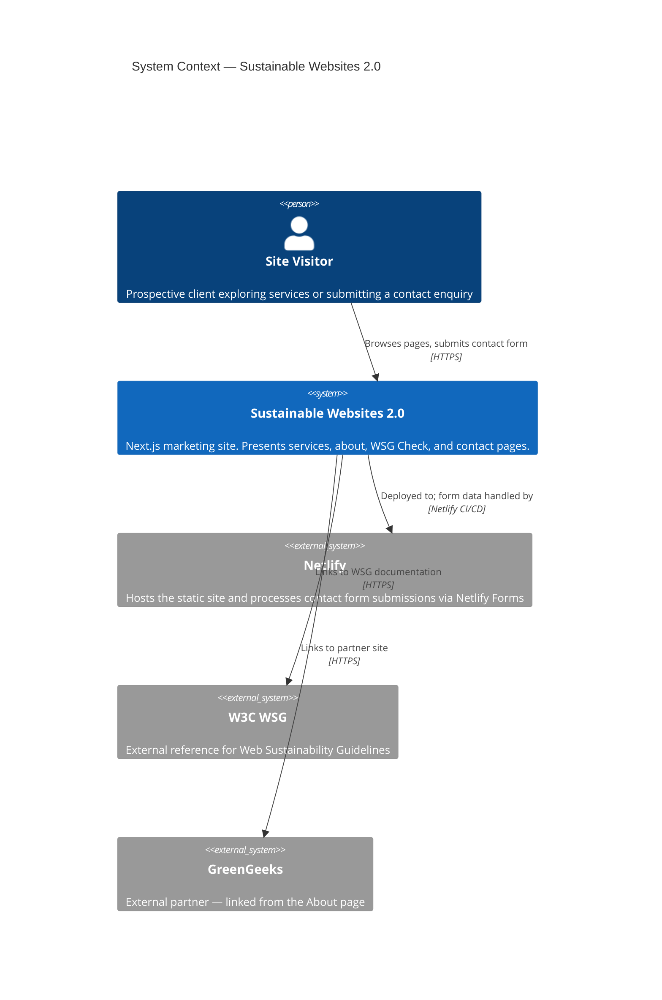
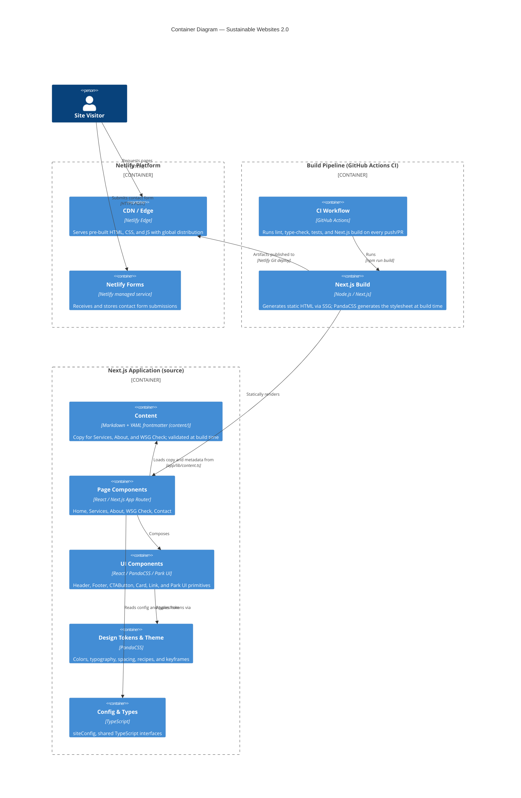

# Architecture Overview

Sustainable Websites 2.0 is a static-first marketing and consulting site built
with Next.js, deployed to Netlify. The system applies the
[C4 model](https://c4model.com/) to describe context, containers, and
components.

Significant decisions are recorded in the
[Architecture Decision Log](adr/README.md). One is open: whether to move to
Astro ([ADR-0006](adr/0006-evaluate-astro-framework.md)). This document
describes the system as it is today. The site's purpose is set by
[ADR-0007](adr/0007-umbrella-brand-and-primary-product.md): it is the front door
for the Sustainable Websites brand and its primary product, WSG-Check, which
lives in a separate repository and application.

## C4 Level 1 — System Context

The diagram below shows the system and its primary actors and external
dependencies.

## C4 Level 2 — Container Diagram

The diagram below shows the major runtime and build-time containers.

## Component Overview

### Pages (App Router)

All routes live under `app/` using the Next.js App Router. Every page exports
static metadata and is rendered as a Server Component, producing zero
client-side JavaScript unless explicitly required.

| Route        | File                             | Purpose                                                                         |
| ------------ | -------------------------------- | ------------------------------------------------------------------------------- |
| `/`          | `app/page.tsx`                   | Hero, benefits summary, service teasers, CTA                                    |
| `/services`  | `app/(pages)/services/page.tsx`  | Full service cards (Audit, Architecture, DevOps); copy in `content/services.md` |
| `/about`     | `app/(pages)/about/page.tsx`     | Founder story, mission, WSG context; copy in `content/about.md`                 |
| `/wsg-check` | `app/(pages)/wsg-check/page.tsx` | Placeholder for the WSG audit tool; copy in `content/wsg-check.md`              |
| `/contact`   | `app/(pages)/contact/page.tsx`   | Netlify Forms contact form                                                      |

### Content (`content/`)

Page copy lives in Markdown files with YAML frontmatter
([ADR-0005](adr/0005-markdown-content-source.md)). Frontmatter holds structured
fields (title, description, headings, calls to action, and the Services cards);
the Markdown body holds prose. `app/lib/content.ts` reads and validates each
file at build time and fails the build on malformed frontmatter.
`app/components/Markdown.tsx` renders the body with the site's own components.
The pages stay static Server Components.

### Layout

`app/layout.tsx` wraps every page with `<Header>`, `<main>`, and `<Footer>`.
It also exports shared `Metadata` (title template, description) and a
`Viewport` configuration derived from `siteConfig`.

### Application Components (`app/components/`)

| Component   | Description                                                                                                              |
| ----------- | ------------------------------------------------------------------------------------------------------------------------ |
| `Header`    | Site-wide navigation bar; reads nav links from `siteConfig`                                                              |
| `Footer`    | Site-wide footer with copyright notice                                                                                   |
| `CTAButton` | Styled anchor wrapped in Park UI `Button`; supports `primary`/`secondary` variants and `sm`/`md`/`lg` sizes              |
| `Card`      | Wraps Park UI `Card`; optionally rendered as a link when `href` is supplied                                              |
| `Link`      | Styled anchor with `primary`, `nav`, `brand`, and `subtle` variants; sets `rel="noopener noreferrer"` for external links |

### Park UI Primitives (`app/components/ui/`)

Thin wrappers around Ark UI components styled with PandaCSS recipes. Exported
from a single `index.ts` barrel: `Button`, `Card`, `Field`, `Input`, `Textarea`,
`Select`, `Spinner`, `Loader`, `Group`, `Span`, `AbsoluteCenter`.

### Design System (`theme/`)

PandaCSS configuration (`panda.config.ts`) references:

- **Color tokens** — `sage` (gray scale), `green`, `grass`, `blue`, `red`
- **Semantic tokens** — `fg.default`, `fg.muted`, `border`, `error`, `blue`, `gray`, `green`
- **Recipes** — per-component style variants for `Button`, `Card`, `Field`, `Input`, `Textarea`, `Select`, `Spinner`, `Group`
- **Text styles, layer styles, keyframes, animation styles** — global typography and motion

### Config, Content Loader, and Types (`app/lib/`, `app/types/`)

`siteConfig` in `app/lib/config.ts` is the single source of truth for the site
name, description, and navbar links. `app/lib/content.ts` loads and validates
the Markdown content described above. Shared TypeScript interfaces (`SiteConfig`,
`NavLink`, `CTAButtonProps`, `CardProps`, `PageProps`) live in `app/types/index.ts`.

## Architecture Decisions

| ADR                                                    | Decision                                                                     |
| ------------------------------------------------------ | ---------------------------------------------------------------------------- |
| [0002](adr/0002-nextjs-static-generation.md)           | Next.js with static generation                                               |
| [0003](adr/0003-pandacss-park-ui.md)                   | PandaCSS and Park UI for styling                                             |
| [0004](adr/0004-netlify-hosting-and-forms.md)          | Netlify hosting and Netlify Forms                                            |
| [0005](adr/0005-markdown-content-source.md)            | Markdown as the content source of truth                                      |
| [0006](adr/0006-evaluate-astro-framework.md)           | Evaluate Astro as the site framework (proposed)                              |
| [0007](adr/0007-umbrella-brand-and-primary-product.md) | Sustainable Websites is the umbrella brand; WSG-Check is the primary product |

The full log, statuses, and the template for new records are in
[`docs/adr/`](adr/README.md).
