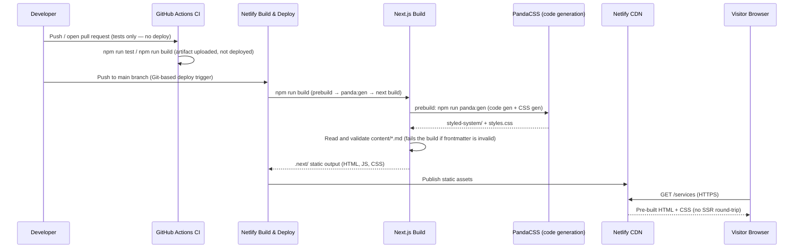

# Data Flows

This document describes how data moves through Sustainable Websites 2.0 at
runtime and during form submission.

## Page Rendering — Static Site Generation (SSG)

All pages are Server Components rendered at build time by Next.js (SSG). The
browser receives complete HTML from Netlify's CDN; no client-side data fetching
occurs.



### Key points

- PandaCSS code generation runs before every `next build` (see `prebuild` in
  `package.json`), producing `styled-system/` artifacts and a single
  `styles.css`.
- `next.config.ts` enables `compress: true` and removes the `X-Powered-By`
  header.
- Each page exports a `metadata` object (title, description) consumed by
  Next.js to generate `<head>` tags at build time — no runtime metadata
  resolution. For Services, About, and WSG Check, the values come from the
  frontmatter of `content/*.md`.
- Page copy is read from `content/*.md` by `app/lib/content.ts` during the
  build. Nothing is read at request time
  ([ADR-0005](adr/0005-markdown-content-source.md)).
- Pages are fully static HTML, but the Next.js client runtime is still shipped
  to the browser; see [ADR-0006](adr/0006-evaluate-astro-framework.md) for
  measurements.
- The `Header` component reads navigation links from the static `siteConfig`
  object; no API call is involved.

## Contact Form Submission — Netlify Forms

The `/contact` page renders the `ContactForm` client component, which submits
with `fetch` to the static blueprint at `/forms.html`. Netlify's Next.js Runtime
v5 ignores full-page POSTs to Next.js routes, so the AJAX submit is required. Form
processing is handled entirely by Netlify's edge network; no custom API route or
server function is required.

```mermaid
sequenceDiagram
  participant Browser as Visitor Browser
  participant Netlify as Netlify Forms Service
  participant Owner as Site Owner (email)

  Browser->>Browser: User fills in Name, Email, Message (optionally Company, Service)
  Browser->>Netlify: fetch POST /forms.html (application/x-www-form-urlencoded, includes form-name=contact)
  Netlify->>Netlify: Validate submission (honeypot bot-field check)
  Netlify-->>Browser: 200 OK; ContactForm shows a success message
  Netlify->>Owner: Email notification (configured in Netlify dashboard)
```

### Form submission details

- `data-netlify="true"` on the `<form>` element instructs Netlify to intercept
  submissions at the edge.
- A hidden `<input name="form-name" value="contact">` field identifies the form
  to Netlify.
- A honeypot `<input name="bot-field">` hidden with CSS catches automated
  submissions without a CAPTCHA.
- Required fields are `name`, `email`, and `message`; `company` and `service`
  are optional.
- `ContactForm` tracks idle, submitting, success, and error states, and shows
  an error message if the POST fails so a lost submission is visible to the
  visitor.
